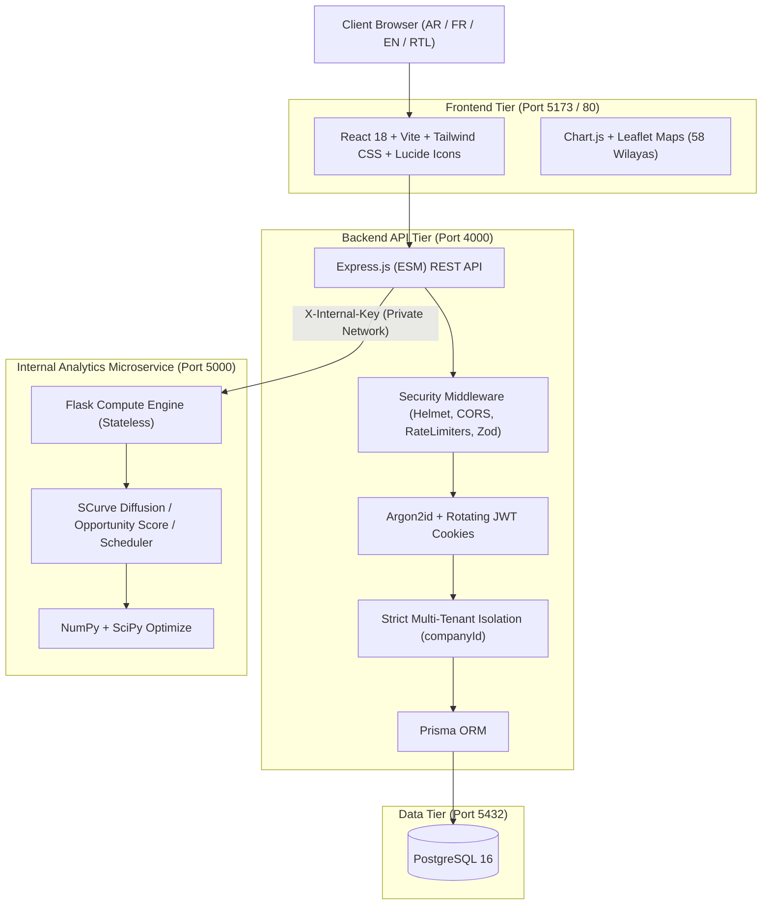

# SOMS — Social Marketing Services (منصة الخدمات التسويقية)

**SOMS** is an enterprise-grade social marketing and campaign analytics platform specifically tailored for the **Algerian market**. It empowers businesses, marketing teams, and analysts to import, analyze, model, and project their marketing performance across Algeria's 58 wilayas with multi-lingual (Arabic, French, English) and right-to-left (RTL) capabilities.

---

## 🏛️ System Architecture



---

## 🚀 Tech Stack

| Layer | Technologies |
|---|---|
| **Frontend** | React 18, Vite, Tailwind CSS, TanStack Query, React Hook Form, Chart.js, Leaflet, i18next (AR/FR/EN with RTL) |
| **API Backend** | Node.js 20 (ESM), Express.js, Prisma ORM, Argon2id, JWT (Access + Rotating Refresh Cookies), Zod, Multer, Pino |
| **Compute Microservice** | Python 3.12, Flask, Gunicorn, NumPy, SciPy (`curve_fit`), Pydantic |
| **Database** | PostgreSQL 16 (Relational models, ENUMs, transactional staging & commit/rollback) |
| **Testing** | Vitest + Supertest (181 integration & unit tests), Pytest (15 compute tests) |
| **DevOps / Containers** | Docker, Docker Compose, Multi-stage Dockerfiles, Nginx Alpine |

---

## 📦 System Modules (Systems 0 – 10)

1. **System 0 — Foundation**: Docker environment, Express & Flask microservice skeletons, i18n structure with dynamic RTL switching, health probes (`/api/health`, `/health`).
2. **System 1 — Authentication & Authorization**: Argon2id password hashing, short-lived JWT access tokens (15m), HttpOnly rotating refresh tokens (7d), brute-force account lockout (5 attempts -> 15 min lock).
3. **System 2 — Company Registration & Admin Approval**: Self-service onboarding for Algerian businesses, admin request queues (`PENDING`, `APPROVED`, `REJECTED`), audit trails.
4. **System 3 — Users, Roles & Activity Logs**: RBAC matrix (`SUPER_ADMIN`, `COMPANY_ADMIN`, `ANALYST`, `VIEWER`), user management, system settings, non-repudiation activity audit log.
5. **System 4 — Data Import Wizard**: CSV ingestion with preview, column mapping, header validation, data mode separation (`real` vs `demo`), wilaya normalization across all 58 Algerian wilayas, atomic commit/rollback.
6. **System 5 — Wilaya & Regional Analytics**: Interactive 58-wilaya Leaflet choropleth map, regional performance breakdowns (Center, East, West, South, Highlands), density and per-capita metrics.
7. **System 6 — Growth & Market Expansion**: Historical trends, period-over-period delta calculation, composite Wilaya Opportunity Scoring algorithm (growth, conversion, leads, CAC, margin).
8. **System 7 — Scheduler Analytics**: 7x24 engagement heatmap, peak interaction window ranking, internal editorial calendar planning (`DRAFT`, `SCHEDULED`, `PUBLISHED`, `ARCHIVED`).
9. **System 8 — S-Curve Diffusion Forecast**: Custom logistic S-Curve diffusion model with Monte Carlo stochastic noise paths (P10, P50, P90 bands), Scipy calibration on past campaigns, baseline scenario comparisons.
10. **System 9 — Snapshot Reports & Executive Hub**: KPI summary counters, module readiness checks, frozen point-in-time snapshot reports, CSV export with Excel Arabic UTF-8 BOM (`\uFEFF`) and CSV formula injection guards (`'`, `=`, `+`, `-`, `@`).
11. **System 10 — Hardening, Testing & Production Delivery**: Production Docker Compose configuration with network isolation, non-root user execution, automated backup & restore scripts, 196 passing automated tests.

---

## 🛠️ Prerequisites

| Requirement | Minimum Version | Notes |
|---|---|---|
| **Node.js** | ≥ 20.x | Required for API and Web build |
| **npm** | ≥ 10.x | Package manager |
| **Docker & Docker Compose** | ≥ 24.x | Containerization and Postgres engine |
| **Python** | ≥ 3.12 | Required for Flask microservice (in local dev mode) |

---

## ⚡ Quick Start (Development)

### 1. Environment Setup

Copy sample environment files for all services:

```bash
# Root
cp .env.example .env

# Backend API
cp api/.env.example api/.env

# Frontend Web
cp web/.env.example web/.env

# Analytics Microservice
cp analytics/.env.example analytics/.env
```

> **Security Note:** In production, replace default secrets (`JWT_ACCESS_SECRET`, `INTERNAL_API_KEY`, etc.) with secure random strings (minimum 32 characters).

### 2. Start PostgreSQL Container

```bash
docker compose up -d postgres
```

### 3. Run Database Migrations and Initial Seed

```bash
cd api
npm install
npm run db:migrate    # Applies Prisma migrations through System 9
npm run db:seed       # Seeds superadmin, 58 Algerian wilayas, and demo datasets
cd ..
```

### 4. Start the Services

Open three terminal windows (or tabs):

- **Terminal 1 — Express API (Port 4000):**
  ```bash
  cd api
  npm run dev
  ```

- **Terminal 2 — Flask Analytics (Port 5000):**
  ```bash
  cd analytics
  python -m venv .venv
  # Windows: .venv\Scripts\activate
  # Linux/macOS: source .venv/bin/activate
  pip install -r requirements.txt
  python app.py
  ```

- **Terminal 3 — React Frontend (Port 5173):**
  ```bash
  cd web
  npm install
  npm run dev
  ```

Visit the application in your browser at `http://localhost:5173`.

---

## 🚢 Production Deployment (Docker Compose)

For production, run the entire containerized stack with a single command:

```bash
docker compose -f docker-compose.prod.yml up -d --build
```

### Production Architecture Features:
- **Zero Exposed Internal Ports:** The `analytics` service runs strictly within the private `soms_internal` bridge network and is not exposed to the public internet or host ports.
- **Reverse Proxy / SPA Nginx:** The `web` container serves the compiled Vite assets with gzip compression, security headers, and client-side SPA fallback.
- **Least-Privilege Security:** Node.js and Flask containers run as non-root users (`nodejs:nodejs` and `flask:flask`).
- **Persistent Storage:** Database files are preserved on the named Docker volume `soms_pgdata_prod`.

---

## 🧪 Running Automated Tests

### 1. Backend Integration & Unit Tests (181 Tests)
Tests authenticate real requests, test tenant isolation, RBAC permissions, and database transactions:

```bash
cd api
npm test
```

### 2. Analytics Microservice Tests (15 Tests)
Tests algorithm correctness, Scipy calibration, and internal API key authentication:

```bash
pytest analytics/tests -v
```

### 3. Frontend Production Build Check
Validates syntax, JSX, CSS compilation, and asset bundling:

```bash
cd web
npm run build
```

---

## 💾 Backup and Disaster Recovery

### Automated Backup
Creates a compressed, timestamped database dump with a 30-day retention cleanup:

- **Linux / macOS (Bash):**
  ```bash
  ./scripts/backup.sh [output_directory]
  ```
- **Windows (PowerShell):**
  ```powershell
  .\scripts\backup.ps1 -BackupDir ".\backups"
  ```

### Database Restore
Restores the database from a specified backup file (prompts for confirmation before overwriting):

- **Linux / macOS (Bash):**
  ```bash
  ./scripts/restore.sh backups/soms_backup_YYYYMMDD_HHMMSS.sql.gz
  ```
- **Windows (PowerShell):**
  ```powershell
  .\scripts\restore.ps1 -BackupFile ".\backups\soms_backup_YYYYMMDD_HHMMSS.sql"
  ```

---

## 🔒 Security Architecture

1. **Multi-Tenant Isolation:** `companyId` is extracted solely from the cryptographically verified JWT payload. All database lookups strictly join on `companyId`. Cross-tenant queries return `404 Not Found` without disclosing record existence.
2. **Brute Force Protection:** IP-based and user-based rate limiting via `express-rate-limit`. Accounts are automatically locked for 15 minutes after 5 consecutive failed login attempts.
3. **Internal Microservice Guard:** The Flask analytics service rejects all requests lacking the pre-shared `X-Internal-Key` header with HTTP 401.
4. **Formula Injection Guard:** All CSV exports sanitize cells starting with `=`, `+`, `-`, or `@` by prefixing them with an apostrophe `'`, preventing formula injection attacks in Microsoft Excel.
5. **Excel Arabic Encoding:** CSV exports prepend the UTF-8 Byte Order Mark (`\uFEFF`), ensuring Arabic text renders correctly in Microsoft Excel on Windows.
6. **No Fake Numbers Guarantee:** The custom helper `divideSafe(n, d)` returns `null` on zero denominators instead of `0` or `Infinity`. The UI explicitly displays "No data / Insufficient data" rather than inventing metrics.

---

## ⚠️ Explicit Scope Boundaries & Limitations

In accordance with the project specification (`docs/SOMS_Build_Spec.md`), the following boundaries apply:
- **No Meta / Instagram Private API Scraping:** SOMS does not utilize illegal scraping or unapproved private APIs. All platform metrics are ingested via structured CSV imports or verified standard business data.
- **No Automatic External Social Publishing:** The scheduler functions as an internal editorial calendar; posts are not directly auto-dispatched to third-party social networks.
- **Sentiments Module Excluded:** In compliance with the project scope agreement, sentiment analysis is excluded and will not be built.
- **Print-Based PDF Generation:** Server-side PDF generation is postponed; clean browser print stylesheets (`@media print`) are provided for generating PDF reports directly from the browser.

---

## 👥 Default Credentials (Demo / Seeding)

| Role | Email | Password |
|---|---|---|
| **Super Admin** | `admin@soms.dz` | `Admin123456!` |
| **Company Admin** | `admin@brand-dz.com` | `Password123!` |
